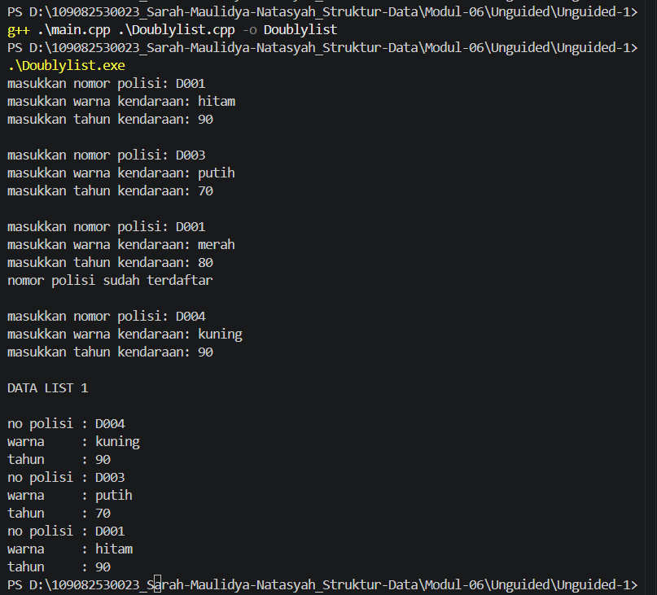
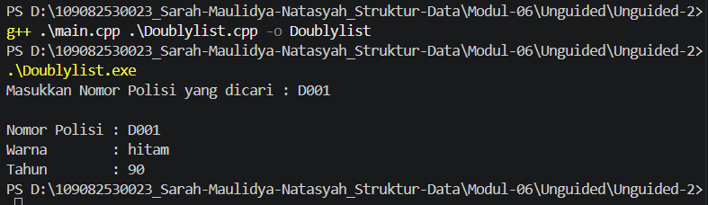
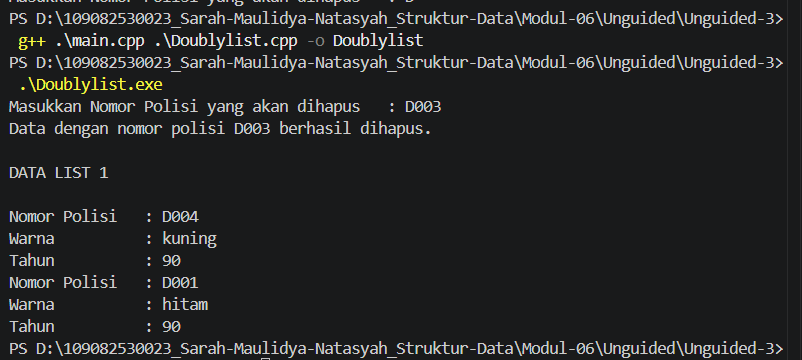

# <h1 align="center">Laporan Praktikum Modul 6 - Doubly Linked List (Bagian Pertama) </h1>
<p align="center">Sarah Maulidya Natasyah - 109082530023</p>

## Dasar Teori
### A. Doubly Linked List <br/>
Doubly linked list adalah linked list yang setiap node-nya memiliki dua pointer, yaitu ```prev``` yang menunjuk ke node sebelumnya dan ```next``` yang menunjuk ke node sesudahnya [1]. Setiap node terdiri dari tiga bagian, yaitu data, pointer ke node berikutnya, dan pointer ke node sebelumnya [2]. Dengan dua pointer ini, list dapat ditelusuri dari depan ke belakang maupun dari belakang ke depan [2]. List dikelola oleh dua pointer utama, yaitu ```first``` yang menunjuk ke node pertama dan ```last``` yang menunjuk ke node terakhir [1]. Jika ```first = Nil```, berarti list kosong [1]. Pada node pertama nilai ```prev``` adalah ```Nil```, dan pada node terakhir nilai ```next``` adalah ```Nil``` [1].

### B. Deklarasi Struktur Data <br/>
Deklarasi struktur data doubly linked list ditulis pada file header (```.h```) [1]. 
Contohnya:
```C++
#define Nil NULL

typedef int infotype;
typedef struct elmlist *address;

struct elmlist {
    infotype info;
    address next;
    address prev;
};

struct list {
    address first;
    address last;
};
```
```infotype``` adalah tipe data yang disimpan, ```address``` adalah pointer ke elemen, dan ```list``` menyimpan ```first``` dan ```last``` sebagai penunjuk elemen pertama dan terakhir [1].

### C. Insert <br/>
Insert adalah operasi untuk menambah node ke dalam list. Node baru dialokasikan dengan ```alokasi```, lalu ```next``` dan ```prev```-nya diisi ```Nil``` sebelum disambungkan [1]. Karena setiap node punya dua pointer, penyisipan harus memperbarui pointer ke dua arah, yaitu ```next``` dan ```prev``` [2].
#### 1. Insert First
Node baru selalu ditempatkan di awal list. ```next``` node baru diarahkan ke ```first```, ```prev``` node pertama lama diarahkan ke node baru, lalu ```first``` dipindahkan ke node baru [1].
```C++
void insertFirst(list &L, address P) {
    if (L.first == Nil) {
        L.first = P;
        L.last = P;
    } else {
        P->next = L.first;
        (L.first)->prev = P;
        L.first = P;
    }
}
```
#### 2. Insert Last
Node baru ditempatkan di akhir list. ```prev``` node baru diarahkan ke ```last```, ```next``` node terakhir lama diarahkan ke node baru, lalu last dipindahkan ke node baru [1].
```C++
void insertLast(list &L, address P) {
    if (L.first == Nil) {
        L.first = P;
        L.last = P;
    } else {
        P->prev = L.last;
        (L.last)->next = P;
        L.last = P;
    }
}
```
#### 3. Insert After
Node baru disisipkan setelah node ```Prec``` [1]. Pointer ```next``` dan ```prev``` node baru diarahkan ke tetangganya, lalu tetangga kanan dan ```Prec``` diarahkan kembali ke node baru [1].
```C++
void insertAfter(list &L, address Prec, address P) {
    P->next = Prec->next;
    P->prev = Prec;
    if (Prec->next != Nil) {
        (Prec->next)->prev = P;
    } else {
        L.last = P;
    }
    Prec->next = P;
}
```
#### 4. Insert Before
Insert before merupakan kebalikan dari insert after. Perbedaannya hanya pada pencarian elemennya [1].

### D. Delete <br/>
Delete adalah operasi untuk menghapus node dari list. Alamat node yang dilepas disimpan pada ```P```, lalu ```next``` dan ```prev```-nya diisi ```Nil``` agar terputus dari list, dan node dapat didealokasi [1]. Jika alamat node yang akan dihapus sudah diketahui, penghapusan dapat dilakukan tanpa perlu menelusuri list dari awal, selama pointer yang diperlukan dapat diakses secara langsung [2].
#### 1. Delete First
```first``` dipindahkan ke node berikutnya, lalu ```prev``` node pertama yang baru diisi ```Nil``` [1].
```C++
void deleteFirst(list &L, address &P) {
    P = L.first;
    if (L.first == L.last) {
        L.first = Nil;
        L.last = Nil;
    } else {
        L.first = P->next;
        (L.first)->prev = Nil;
        P->next = Nil;
    }
}
```
#### 2. Delete Last
```last``` dipindahkan ke node sebelumnya, lalu ```next``` node terakhir yang baru diisi ```Nil``` [1].
```C++
void deleteLast(list &L, address &P) {
    P = L.last;
    if (L.first == L.last) {
        L.first = Nil;
        L.last = Nil;
    } else {
        L.last = P->prev;
        (L.last)->next = Nil;
        P->prev = Nil;
    }
}
```
#### 3. Delete After
Node yang dihapus adalah node setelah ```Prec```. Node tersebut dilewati dengan ```Prec->next = P->next``` dan ```(P->next)->prev = Prec```, lalu ```P``` diputus dari list [1].
```C++
void deleteAfter(address Prec, address &P) {
    P = Prec->next;
    Prec->next = P->next;
    (P->next)->prev = Prec;
    P->prev = Nil;
    P->next = Nil;
}
```
#### 4. Delete Before
Delete before merupakan kebalikan dari delete after. Perbedaannya hanya pada pencarian elemennya [1].

### E. Update, View, dan Searching <br/>
Proses searching, update, dan view pada doubly linked list pada dasarnya sama dengan singly linked list, yaitu dengan menelusuri node satu per satu [1]. Bedanya, akses elemen lebih mudah karena penelusuran dapat dilakukan maju maupun mundur [1]. Contoh penelusuran maju dan mundur:
```C++
void printMaju(list L) {
    for (address P = L.first; P != Nil; P = P->next)
        cout << P->info << " ";
}

void printMundur(list L) {
    for (address P = L.last; P != Nil; P = P->prev)
        cout << P->info << " ";
}
```

## Guided
### a. File Doublylist.h
```C++
#ifndef DOUBLYLIST_H
#define DOUBLYLIST_H
#include <string>
using namespace std;

struct barang {
    string kode;
    string nama;
    int tahun;
};

using infotype = barang;
struct elmlist;
using address = elmlist*;
struct elmlist { infotype info; address prev; address next; };
struct list { address first; address last; };

void CreateList(list &L);
address alokasi(const infotype &x);
void dealokasi(address &P);
void insertFirst(list &L, address P);
void insertLast(list &L, address P);
void insertAfter(list &L, address R, address P);
void insertBefore(list &L, address R, address P);
void printInfo(const list &L);
address findElm(const list &L, const string &kode);
void deleteFirst(list &L, address &P);
void deleteLast(list &L, address &P);
void deleteAfter(list &L, address prec, address &P);
void deleteBefore(list &L, address prec, address &P);
#endif
```
### b. File Doublylist.cpp
```C++
#include <iostream>
#include <iomanip>
#include "Doublylist.h"
using namespace std;

void CreateList(list &L) { L.first = nullptr; L.last = nullptr; }

address alokasi(const infotype &x) {
    address P = new elmlist;
    P->info = x;
    P->prev = nullptr; P->next = nullptr;
    return P;
}
void dealokasi(address &P) {
    if (P != nullptr) { delete P; P = nullptr; }
}
void insertFirst(list &L, address P) {
    if (!P) return;
    P->prev = nullptr; P->next = L.first;
    if (L.first) L.first->prev = P;
    else L.last = P;
    L.first = P;
}
void insertLast(list &L, address P) {
    if (!P) return;
    P->next = nullptr; P->prev = L.last;
    if (L.last) L.last->next = P;
    else L.first = P;
    L.last = P;
}

// Menyisipkan P tepat setelah R.
void insertAfter(list &L, address R, address P) {
    if (!R || !P) return;
    P->prev = R;
    P->next = R->next;
    if (R->next) R->next->prev = P;
    else L.last = P;
    R->next = P;
}

// Menyisipkan P tepat sebelum R.
void insertBefore(list &L, address R, address P) {
    if (!R || !P) return;
    P->next = R;
    P->prev = R->prev;
    if (R->prev) R->prev->next = P;
    else L.first = P;
    R->prev = P;
}
void printInfo(const list &L) {
    address P = L.first;
    if (!P) {
        cout << "List kosong.\n";
        return;
    }

    cout << "+--------+------------+-------+\n";
    cout << "| Kode   | Nama       | Tahun |\n";
    cout << "+--------+------------+-------+\n";
    while (P) {
        cout << "| " << left << setw(6) << P->info.kode
             << " | " << setw(10) << P->info.nama
             << " | " << setw(5) << P->info.tahun << " |\n";
        P = P->next;
    }
    cout << "+--------+------------+-------+\n";
}
address findElm(const list &L, const string &kode) {
    address P = L.first;
    while (P) {
        if (P->info.kode == kode) return P;
        P = P->next;
    }
    return nullptr;
}
void deleteFirst(list &L, address &P) {
    if (!L.first) { P = nullptr; return; }
    P = L.first; L.first = P->next;
    if (L.first) L.first->prev = nullptr;
    else L.last = nullptr;
    P->prev = P->next = nullptr;
}
void deleteLast(list &L, address &P) {
    if (!L.last) { P = nullptr; return; }
    P = L.last; L.last = P->prev;
    if (L.last) L.last->next = nullptr;
    else L.first = nullptr;
    P->prev = P->next = nullptr;
}
// Menghapus node tepat setelah prec.
void deleteAfter(list &L, address prec, address &P) {
    P = nullptr;
    if (!prec || !prec->next) return;
    P = prec->next; prec->next = P->next;
    if (P->next) P->next->prev = prec;
    else L.last = prec;
    P->prev = P->next = nullptr;
}
// Menghapus node tepat sebelum succ.
void deleteBefore(list &L, address succ, address &P) {
    P = nullptr;
    if (!succ || !succ->prev) return;
    P = succ->prev; succ->prev = P->prev;
    if (P->prev) P->prev->next = succ;
    else L.first = succ;
    P->prev = P->next = nullptr;
}
```
### c. File main.cpp
```C++
#include <iostream>
#include "Doublylist.h"
using namespace std;

void tampilkanJudul(const string &judul) {
    cout << "\n========================================\n";
    cout << judul << '\n';
    cout << "========================================\n";
}

int main() {
    list L;
    CreateList(L);

    infotype barang1 = {"B001", "Laptop", 2020};
    infotype barang2 = {"B002", "Monitor", 2022};
    infotype barang3 = {"B003", "Keyboard", 2023};
    infotype barang4 = {"B004", "Mouse", 2024};

    address P = nullptr;
    address posisi = nullptr;

    cout << "DEMONSTRASI OPERASI DOUBLY LINKED LIST\n";
    cout << "Data yang digunakan: B001, B002, B003, dan B004\n";

    tampilkanJudul("[1] INSERT FIRST");
    cout << "Menambahkan B002 di awal list.\n";
    insertFirst(L, alokasi(barang2));
    printInfo(L);

    tampilkanJudul("[2] INSERT LAST");
    cout << "Menambahkan B004 di akhir list.\n";
    insertLast(L, alokasi(barang4));
    printInfo(L);

    tampilkanJudul("[3] INSERT AFTER");
    cout << "Menambahkan B003 setelah B002.\n";
    posisi = findElm(L, "B002");
    if (posisi != nullptr) {
        insertAfter(L, posisi, alokasi(barang3));
    }
    printInfo(L);

    tampilkanJudul("[4] INSERT BEFORE");
    cout << "Menambahkan B001 sebelum B002.\n";
    posisi = findElm(L, "B002");
    if (posisi != nullptr) {
        insertBefore(L, posisi, alokasi(barang1));
    }
    printInfo(L);

    tampilkanJudul("[5] FIND ELEMENT");
    cout << "Mencari barang dengan kode B003.\n";
    posisi = findElm(L, "B003");
    if (posisi != nullptr) {
        cout << "Data ditemukan:\n";
        cout << "  Kode  : " << posisi->info.kode << '\n';
        cout << "  Nama  : " << posisi->info.nama << '\n';
        cout << "  Tahun : " << posisi->info.tahun << '\n';
    } else {
        cout << "Data tidak ditemukan.\n";
    }

    tampilkanJudul("[6] DELETE AFTER");
    cout << "Menghapus node setelah B002 (B003).\n";
    posisi = findElm(L, "B002");
    deleteAfter(L, posisi, P);
    if (P != nullptr) {
        cout << "Node yang dihapus: " << P->info.kode << '\n';
        dealokasi(P);
    } else {
        cout << "Tidak ada node yang dapat dihapus.\n";
    }
    printInfo(L);

    tampilkanJudul("[7] DELETE BEFORE");
    cout << "Menghapus node sebelum B004 (B002).\n";
    posisi = findElm(L, "B004");
    deleteBefore(L, posisi, P);
    if (P != nullptr) {
        cout << "Node yang dihapus: " << P->info.kode << '\n';
        dealokasi(P);
    } else {
        cout << "Tidak ada node yang dapat dihapus.\n";
    }
    printInfo(L);

    tampilkanJudul("[8] DELETE FIRST");
    cout << "Menghapus node pertama.\n";
    deleteFirst(L, P);
    if (P != nullptr) {
        cout << "Node yang dihapus: " << P->info.kode << '\n';
        dealokasi(P);
    } else {
        cout << "List kosong, tidak ada node yang dapat dihapus.\n";
    }
    printInfo(L);

    tampilkanJudul("[9] DELETE LAST");
    cout << "Menghapus node terakhir.\n";
    deleteLast(L, P);
    if (P != nullptr) {
        cout << "Node yang dihapus: " << P->info.kode << '\n';
        dealokasi(P);
    } else {
        cout << "List kosong, tidak ada node yang dapat dihapus.\n";
    }
    printInfo(L);

    tampilkanJudul("SELESAI");
    cout << "Kondisi list: "
         << (L.first == nullptr && L.last == nullptr ? "kosong.\n" : "masih berisi data.\n");

    return 0;
}
```
## Penjelasan
### a. File Doublylist.h 
File ```Doublylist.h``` adalah file header yang berisi deklarasi struktur data dan fungsi yang digunakan dalam program. Struct ```barang``` digunakan untuk menyimpan kode, nama, dan tahun barang. Struct ```elmlist``` memiliki ```info```, ```prev```, dan ```next```, sedangkan struct ```list``` menyimpan alamat node pertama (```first```) dan terakhir (```last```). File ini juga berisi deklarasi fungsi untuk menambah, mencari, menampilkan, dan menghapus data.
### b. File Doublylist.cpp 
File ```Doublylist.cpp``` berisi implementasi fungsi yang sudah dideklarasikan di ```Doublylist.h```. Fungsi ```CreateList``` digunakan untuk membuat list kosong, ```alokasi``` untuk membuat node baru, dan ```dealokasi``` untuk menghapus node dari memori. Selain itu, terdapat fungsi untuk menambah, mencari, menampilkan, dan menghapus data dengan mengatur pointer ```prev``` dan ```next```.
### c. File main.cpp
File ```main.cpp``` merupakan program utama untuk mencoba operasi Doubly Linked List. Program akan membuat empat data barang, kemudian menjalankan operasi penambahan, pencarian, dan penghapusan node. Hasil setiap operasi ditampilkan menggunakan ```printInfo``` agar perubahan isi list dapat dilihat sampai program selesai.

## Unguided 

### 1. Buatlah ADT Doubly Linked list sebagai berikut di dalam file “Doublylist.h”:
```C++
Type infotype : kendaraan <
nopol : string
warna : string
thnBuat : integer
>
Type address : pointer to ElmList
Type ElmList <
info : infotype
next :address
prev : address
>
Type List <
First : address
Last : address
>
procedure CreateList( input/output L : List )
function alokasi( x : infotype ) → address
procedure dealokasi(input/output P : address )
procedure printInfo( input L : List )
procedure insertLast(input/output L : List,
input P : address )
```
Buatlah implementasi ADT Doubly Linked list pada file “Doublylist.cpp” dan coba hasil implementasi ADT pada file “main.cpp”.

Contoh Output:
```
masukkan nomor polisi: D001
masukkan warna kendaraan: hitam
masukkan tahun kendaraan: 90

masukkan nomor polisi: D003
masukkan warna kendaraan: putih
masukkan tahun kendaraan: 70

masukkan nomor polisi: D001
masukkan warna kendaraan: merah
masukkan tahun kendaraan: 80
nomor polisi sudah terdaftar

masukkan nomor polisi: D004
masukkan warna kendaraan: kuning
masukkan tahun kendaraan: 90

DATA LIST 1

no polisi   : D004
warna       : kuning
tahun       : 90
no polisi   : D003
warna       : putih
tahun       : 70
no polisi   : D001
warna       : hitam
tahun       : 90
```
#### a. File Doublylist.h 
```C++
#ifndef DOUBLYLIST_H
#define DOUBLYLIST_H
#define Nil NULL

#include <iostream>
#include <string>
using namespace std;

struct kendaraan {
    string nopol;
    string warna;
    int thnBuat;
};
typedef kendaraan infotype;
typedef struct ElmList *address;

struct ElmList {
    infotype info;
    address next;
    address prev;
};

struct List {
    address First;
    address Last;
};

void CreateList(List &L);
address alokasi(infotype x);
void dealokasi(address &P);
void printInfo(List L);
void insertLast(List &L, address P);

#endif
```
#### b. File Doublylist.cpp 
```C++
#include "Doublylist.h"

void CreateList(List &L) {
    L.First = Nil;
    L.Last = Nil;
}

address alokasi(infotype x) {
    address P = new ElmList;
    P->info = x;
    P->next = Nil;
    P->prev = Nil;
    return P;
}

void dealokasi(address &P) {
    if (P != Nil) {
        delete P;
        P = Nil;
    }
}

void printInfo(List L) {
    address P = L.Last;
    while (P != Nil) {
        cout << "no polisi : " << P->info.nopol << endl;
        cout << "warna     : " << P->info.warna << endl;
        cout << "tahun     : " << P->info.thnBuat << endl;
        P = P->prev;
    }
}

void insertLast(List &L, address P) {
    if (L.First == Nil) {
        L.First = P;
        L.Last = P;
    } else {
        P->prev = L.Last;
        (L.Last)->next = P;
        L.Last = P;
    }
}
```
#### c. File main.cpp
```C++
#include <iostream>
#include "Doublylist.h"
using namespace std;

int main() {
    List L;
    infotype x;
    address P;
    CreateList(L);

    for (int i = 0; i < 4; i++) {
        cout << "masukkan nomor polisi: ";
        cin >> x.nopol;
        cout << "masukkan warna kendaraan: ";
        cin >> x.warna;
        cout << "masukkan tahun kendaraan: ";
        cin >> x.thnBuat;

        bool ada = false;
        P = L.First;
        while (P != Nil && !ada) {
            if (P->info.nopol == x.nopol) {
                ada = true;
            }
            P = P->next;
        }

        if (ada) {
            cout << "nomor polisi sudah terdaftar" << endl;
        } else {
            P = alokasi(x);
            insertLast(L, P);
        }
        cout << endl;
    }

    cout << "DATA LIST 1" << endl << endl;
    printInfo(L);

    return 0;
}
```
### Output Unguided 1 :

##### Output 1


### Penjelasan
#### a. File Doublylist.h 
File ```Doublylist.h``` adalah file header yang berisi deklarasi struktur data dan fungsi yang digunakan dalam program. Struct ```kendaraan``` menyimpan nomor polisi (```nopol```), warna (```warna```), dan tahun pembuatan (```thnBuat```). Struct ```ElmList``` memiliki ```info```, ```next```, dan ```prev```, sedangkan struct ```List``` menyimpan alamat elemen pertama (```First```) dan terakhir (```Last```). Terdapat juga lima fungsi yaitu: ```CreateList```, ```alokasi```, ```dealokasi```, ```printInfo```, dan ```insertLast```.
#### b. File Doublylist.cpp 
File ```Doublylist.cpp``` berisi implementasi fungsi yang sudah dideklarasikan di ```Doublylist.h```. ```CreateList``` membuat list kosong, ```alokasi``` membuat elemen baru, dan ```dealokasi``` menghapus elemen dari memori. ```printInfo``` akan menampilkan isi list dari ```Last``` mundur lewat ```prev```, sedangkan ```insertLast``` menambahkan elemen di akhir list dengan mengatur pointer ```prev``` dan ```next```.
#### c. File main.cpp
File ```main.cpp``` merupakan program utama untuk mencoba Doubly Linked List. Program meminta input data kendaraan sebanyak empat kali, lalu mengecek apakah nomor polisi sudah ada di list. Jika sudah ada, program menampilkan pesan "nomor polisi sudah terdaftar". Jika belum, data dimasukkan dengan ```alokasi``` dan ```insertLast```. Setelah itu, seluruh isi list ditampilkan menggunakan ```printInfo```.

### 2. Carilah elemen dengan nomor polisi D001 dengan membuat fungsi baru.
```fungsi findElm( L : List, x : infotype ) : address```

Contoh Output:
```
Masukkan Nomor Polisi yang dicari: D001

Nomor Polisi    : D001
Warna           : hitam
Tahun           : 90
```
#### a. File Doublylist.h 
```C++
#ifndef DOUBLYLIST_H
#define DOUBLYLIST_H
#define Nil NULL

#include <iostream>
#include <string>
using namespace std;

struct kendaraan {
    string nopol;
    string warna;
    int thnBuat;
};
typedef kendaraan infotype;
typedef struct ElmList *address;

struct ElmList {
    infotype info;
    address next;
    address prev;
};

struct List {
    address First;
    address Last;
};

void CreateList(List &L);
address alokasi(infotype x);
void dealokasi(address &P);
void printInfo(List L);
void insertLast(List &L, address P);
address findElm(List L, infotype x);

#endif
```
#### b. File Doublylist.cpp 
```C++
#include "Doublylist.h"

void CreateList(List &L) {
    L.First = Nil; 
    L.Last = Nil;
}

address alokasi(infotype x) {
    address P = new ElmList;
    P->info = x;
    P->next = Nil; 
    P->prev = Nil;
    return P;
}

void dealokasi(address &P) {
    if (P != Nil) { 
        delete P; 
        P = Nil; 
    }
}

void printInfo(List L) {
    address P = L.Last;
    while (P != Nil) {
        cout << "no polisi : " << P->info.nopol << '\n';
        cout << "warna     : " << P->info.warna << '\n';
        cout << "tahun     : " << P->info.thnBuat << '\n';
        P = P->prev;
    }
}

void insertLast(List &L, address P) {
    if (P == Nil) {
        return;
    }
    P->next = Nil;
    P->prev = L.Last;
    if (L.Last != Nil) {
        L.Last->next = P;
    } else {
        L.First = P;
    }
    L.Last = P;
}

address findElm(List L, infotype x) {
    address P = L.First;
    while (P != Nil) {
        if (P->info.nopol == x.nopol) {
            return P;
        }
        P = P->next;
    }
    return Nil;
}
```
#### c. File main.cpp
```C++
#include <iostream>
#include "Doublylist.h"
using namespace std;

int main() {
    List L;
    CreateList(L);

    insertLast(L, alokasi({"D001", "hitam", 90}));
    insertLast(L, alokasi({"D003", "putih", 70}));
    insertLast(L, alokasi({"D004", "kuning", 90}));

    infotype x;
    cout << "Masukkan Nomor Polisi yang dicari   : ";
    cin >> x.nopol;

    address P = findElm(L, x);

    if (P != Nil) {
        cout << "\nNomor Polisi   : " << P->info.nopol << endl;
        cout << "Warna          : " << P->info.warna << endl;
        cout << "Tahun          : " << P->info.thnBuat << endl;
    }

    return 0;
}
```
### Output Unguided 2 :

##### Output 1


### Penjelasan
#### a. File Doublylist.h 
File ```Doublylist.h``` adalah file header yang berisi deklarasi struktur data dan fungsi yang digunakan dalam program. Struct ```kendaraan``` menyimpan nomor polisi (```nopol```), warna (```warna```), dan tahun pembuatan (```thnBuat```). Struct ```ElmList``` memiliki ```info```, ```next```, dan ```prev```, sedangkan struct ```List``` menyimpan alamat elemen pertama (```First```) dan terakhir (```Last```). Pada nomor ini ditambahkan deklarasi fungsi ```findElm``` untuk mencari elemen, sehingga total ada enam fungsi: ```CreateList```, ```alokasi```, ```dealokasi```, ```printInfo```, ```insertLast```, dan ```findElm```.
#### b. File Doublylist.cpp 
File ```Doublylist.cpp``` berisi implementasi fungsi yang sudah dideklarasikan di ```Doublylist.h```. ```CreateList``` membuat list kosong, ```alokasi``` membuat elemen baru, dan ```dealokasi``` menghapus elemen dari memori. ```printInfo``` menampilkan isi list dari ```Last``` mundur lewat ```prev```, sedangkan ```insertLast``` menambahkan elemen di akhir list. Fungsi baru ```findElm``` menelusuri list dari ```First``` lewat ```next``` untuk mencari elemen dengan nomor polisi yang sama. Jika ditemukan, fungsi mengembalikan alamat elemen tersebut, jika tidak maka mengembalikan ```Nil```.
#### c. File main.cpp
File ```main.cpp``` merupakan program utama untuk mencoba fungsi pencarian. Program membuat list berisi tiga data kendaraan (D001, D003, D004) dengan ```alokasi``` dan ```insertLast```. Program lalu meminta input nomor polisi yang dicari dan memanggil ```findElm```. Jika elemen ditemukan, program menampilkan nomor polisi, warna, dan tahun kendaraan tersebut.

### 3. Hapus elemen dengan nomor polisi D003 dengan procedure delete.
- procedure deleteFirst( input/output L : List, P : address )
- procedure deleteLast( input/output L : List, P : address )
- procedure deleteAfter( input Prec : address, input/output P : address )

Contoh Output:
```
Masukkan Nomor Polisi yang akan dihapus: D003
Data dengan nomor polisi D003 berhasil dihapus.

DATA LIST 1

Nomor Polisi    : D004
Warna           : kuning
Tahun           : 90
Nomor Polisi    : D001
Warna           : hitam
Tahun           : 90
```
#### a. File Doublylist.h 
```C++
#ifndef DOUBLYLIST_H
#define DOUBLYLIST_H
#define Nil NULL

#include <iostream>
#include <string>
using namespace std;

struct kendaraan {
    string nopol;
    string warna;
    int thnBuat;
};

typedef kendaraan infotype;
typedef struct ElmList *address;

struct ElmList {
    infotype info;
    address next;
    address prev;
};

struct List {
    address First;
    address Last;
};

void CreateList(List &L);
address alokasi(infotype x);
void dealokasi(address &P);
void printInfo(List L);
void insertLast(List &L, address P);
address findElm(List L, infotype x);
void deleteFirst(List &L, address &P);
void deleteLast(List &L, address &P);
void deleteAfter(address Prec, address &P);

#endif
```
#### b. File Doublylist.cpp 
```C++
#include "Doublylist.h"

void CreateList(List &L) {
    L.First = Nil;
    L.Last = Nil;
}

address alokasi(infotype x) {
    address P = new ElmList;
    P->info = x;
    P->next = Nil;
    P->prev = Nil;
    return P;
}

void dealokasi(address &P) {
    if (P != Nil) {
        delete P;
        P = Nil;
    }
}


void printInfo(List L) {
    address P = L.Last;

    while (P != Nil) {
        cout << "Nomor Polisi   : " << P->info.nopol << endl;
        cout << "Warna          : " << P->info.warna << endl;
        cout << "Tahun          : " << P->info.thnBuat << endl;
        P = P->prev;
    }
}


void insertLast(List &L, address P) {
    if (P == Nil) return;

    P->prev = L.Last;
    P->next = Nil;

    if (L.Last != Nil) {
        L.Last->next = P;
    } else {
        L.First = P;
    }

    L.Last = P;
}

address findElm(List L, infotype x) {
    address P = L.First;

    while (P != Nil) {
        if (P->info.nopol == x.nopol) {
            return P;
        }
        P = P->next;
    }

    return Nil;
}

void deleteFirst(List &L, address &P) {
    P = L.First;
    if (P == Nil) return;

    L.First = P->next;

    if (L.First != Nil) {
        L.First->prev = Nil;
    } else {
        L.Last = Nil;
    }

    P->next = Nil;
}

void deleteLast(List &L, address &P) {
    P = L.Last;
    if (P == Nil) return;

    L.Last = P->prev;

    if (L.Last != Nil) {
        L.Last->next = Nil;
    } else {
        L.First = Nil;
    }

    P->prev = Nil;
}

void deleteAfter(address Prec, address &P) {
    P = Nil;
    if (Prec == Nil || Prec->next == Nil) return;

    P = Prec->next;
    Prec->next = P->next;

    if (P->next != Nil) {
        P->next->prev = Prec;
    }

    P->prev = Nil;
    P->next = Nil;
}
```
#### c. File main.cpp
```C++
#include <iostream>
#include "Doublylist.h"
using namespace std;

int main() {
    List L;
    CreateList(L);

    insertLast(L, alokasi({"D001", "hitam", 90}));
    insertLast(L, alokasi({"D003", "putih", 70}));
    insertLast(L, alokasi({"D004", "kuning", 90}));

    infotype x;
    cout << "Masukkan Nomor Polisi yang akan dihapus   : ";
    cin >> x.nopol;

    address target = findElm(L, x);
    address P = Nil;

    if (target == Nil) {
        cout << "Data dengan nomor polisi " << x.nopol
             << " tidak ditemukan." << endl;
        return 0;
    }

    if (target == L.First) {
        deleteFirst(L, P);
    } else if (target == L.Last) {
        deleteLast(L, P);
    } else {
        deleteAfter(target->prev, P);
    }

    cout << "Data dengan nomor polisi " << P->info.nopol
         << " berhasil dihapus." << endl;

    dealokasi(P);

    cout << "\nDATA LIST 1\n\n";
    printInfo(L);

    return 0;
}
```
### Output Unguided 3 :

##### Output 1


### Penjelasan
#### a. File Doublylist.h 
File ```Doublylist.h``` adalah file header yang berisi deklarasi struktur data dan fungsi yang digunakan dalam program. Struct ```kendaraan``` menyimpan nomor polisi (```nopol```), warna (```warna```), dan tahun pembuatan (```thnBuat```). Struct ```ElmList``` memiliki ```info```, ```next```, dan ```prev```, sedangkan struct ```List``` menyimpan alamat elemen pertama (```First```) dan terakhir (```Last```). Pada nomor ini ditambahkan deklarasi tiga prosedur penghapusan, yaitu ```deleteFirst```, ```deleteLast```, dan ```deleteAfter```, di samping fungsi sebelumnya (```CreateList```, ```alokasi```, ```dealokasi```, ```printInfo```, ```insertLast```, dan ```findElm```).
#### b. File Doublylist.cpp 
File ```Doublylist.cpp``` berisi implementasi fungsi yang sudah dideklarasikan di ```Doublylist.h```. ```CreateList``` membuat list kosong, ```alokasi``` membuat elemen baru, ```dealokasi``` menghapus elemen dari memori, ```printInfo``` menampilkan isi list dari ```Last``` mundur lewat ```prev```, ```insertLast``` menambahkan elemen di akhir list, dan ```findElm``` mencari elemen berdasarkan nomor polisi. Prosedur baru ```deleteFirst``` melepas elemen pertama, ```deleteLast``` melepas elemen terakhir, dan ```deleteAfter``` melepas elemen setelah ```Prec```. Ketiganya mengatur ulang pointer ```next``` dan ```prev``` agar list tetap tersambung, lalu mengembalikan elemen yang dilepas lewat parameter ```P```.
#### c. File main.cpp
File ```main.cpp``` merupakan program utama untuk mencoba penghapusan elemen. Program membuat list berisi tiga data kendaraan (D001, D003, D004), lalu meminta nomor polisi yang akan dihapus dan mencarinya dengan ```findElm```. Jika tidak ditemukan, program menampilkan pesan dan berhenti. Jika ditemukan, program memilih prosedur sesuai posisi elemen: ```deleteFirst``` jika di awal, ```deleteLast``` jika di akhir, dan ```deleteAfter``` jika di tengah. Setelah elemen dilepas dari list, program menampilkan pesan berhasil, menghapus elemen dari memori dengan ```dealokasi```, lalu menampilkan sisa isi list menggunakan ```printInfo```.

## Kesimpulan
Berdasarkan praktikum yang telah dilakukan, dapat disimpulkan bahwa doubly linked list adalah struktur data yang terdiri dari node-node yang saling terhubung melalui dua pointer, yaitu ```next``` ke node sesudahnya dan ```prev``` ke node sebelumnya. Dengan dua pointer ini, list dapat ditelusuri maju dari ```First``` maupun mundur dari ```Last```, seperti pada ```printInfo``` yang menampilkan data dari elemen terakhir. Operasi insert dan delete harus memperbarui pointer ke dua arah agar list tetap tersambung, termasuk menangani kasus list kosong, elemen di ujung, dan elemen di tengah. Operasi searching dilakukan dengan menelusuri list node demi node, dan seluruh operasi tersebut disusun sebagai ADT, dengan deklarasi pada file ```.h``` dan implementasi pada file ```.cpp```.

## Referensi
[1] Informatics Lab, Fakultas Informatika, Telkom University. (t.t.). Modul 6: Double Linked List (Bagian Pertama). Telkom University.
<br>[2] Indahyanti, Uce., & Rahmawati Yunianita. (2020). Buku Ajar Algoritma Dan Pemrograman Dalam Bahasa C++. Sidoarjo: Umsida Press. Diakses melalui https://doi.org/10.21070/2020/978-623-6833-67-4.