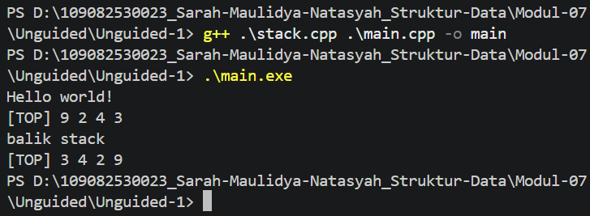
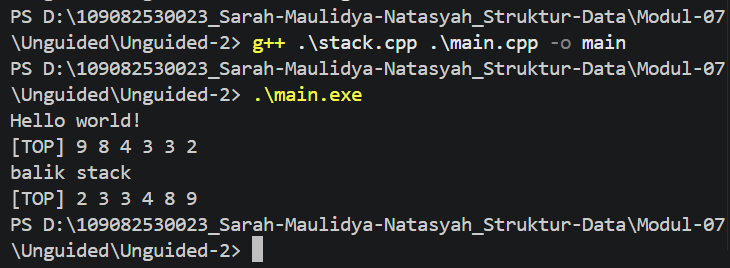
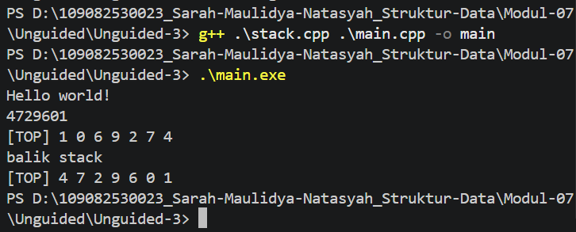

# <h1 align="center">Laporan Praktikum Modul 7 - Stack </h1>
<p align="center">Sarah Maulidya Natasyah - 109082530023</p>

## Dasar Teori
### A. Pengertian Stack <br/>
Stack atau tumpukan adalah bentuk struktur data yang cara kerjanya seperti tumpukan. Stack menggunakan prinsip LIFO (Last In First Out), yaitu yang terakhir masuk adalah yang pertama keluar [1]. Dalam stack, proses penambahan dan pengambilan elemen hanya dilakukan melalui satu bagian yang disebut Top [2].

### B. Komponen-Komponen dalam Stack <br/>
Stack dapat direpresentasikan menggunakan pointer maupun tabel. Pada representasi pointer, setiap elemen memiliki info sebagai tempat menyimpan data dan next sebagai penunjuk ke elemen berikutnya. Sementara itu, stack hanya memiliki satu penunjuk utama, yaitu Top [1].

### C. Operasi dalam Stack<br/>
#### 1. Push
Push adalah operasi untuk menyisipkan elemen ke tumpukan data yang fungsinya sama dengan insert first pada list biasa [1]. Pada proses ini, elemen baru akan ditempatkan di bagian paling atas stack sehingga posisi Top berpindah ke elemen yang baru dimasukkan [1][2]. Contoh kode:
```C++
void push(address P){
    P->next = S.Top;
    S.Top = P;
}
```
#### 2. Pop
Pop adalah operasi pengambilan elemen dari stack yang mirip dengan delete first pada list linear. Elemen yang diambil merupakan elemen paling atas atau elemen yang pertama kali diakses dalam stack [1]. Prosesnya dilakukan dengan menyimpan elemen yang berada di posisi ```Top```, kemudian menggeser ```Top``` ke elemen di bawahnya [1][2].<br>
Contoh kode:
```C++
address pop(address P){
    P = S.Top;
    S.Top = (S.Top)->next;
    return P;
}
```

### D. Primitif-Primitif dalam Stack <br/>
Primitif yang ada dalam stack pada dasarnya sama dengan primitif pada list lainnya, tetapi jumlahnya lebih sedikit karena stack hanya mengoperasikan elemen yang berada di bagian paling atas [1].<br>
Primitif-primitif dalam stack diantaranya:
1. ```createStack()```
2. ```isEmpty()```
3. ```alokasi()```
4. ```dealokasi()```
5. fungsi-fungsi pencarian
6. fungsi primitif lainnya

### E. Stack Representasi Tabel<br/>
Stack representasi tabel pada dasarnya memiliki prinsip kerja yang sama dengan stack representasi pointer. Perbedaannya terletak pada pendeklarasian struktur datanya, yaitu menggunakan array berindeks sehingga jumlah elemen dalam stack terbatas [1]. Batas maksimum jumlah elemen ditandai dengan ```Imax``` [1].
#### 1. Operasi dalam Stack Representasi Tabel
##### a. Push
Penyisipan data dilakukan dengan menggeser indeks Top ke indeks berikutnya ```(Top = Top + 1)```, lalu data disimpan di posisi ```Top``` yang baru [1].
##### b. Pop
Pengambilan data dilakukan pada indeks ```Top``` dengan ```Temp = S.Info[TOP]```, lalu ```TOP = TOP - 1```. Setelah data diambil, ```Top``` bergeser ke indeks sebelumnya tanpa menghilangkan ```info``` dari indeks ```Top``` yang lama [1].
#### 2. Primitif dalam Stack Representasi Tabel
Primitifnya pada dasarnya sama dengan representasi pointer. Bedanya hanya di manajemen memori: pada representasi tabel tidak diperlukan manajemen memori. Primitifnya antara lain ```createStack()```, ```isEmpty()```, fungsi pencarian, dan fungsi primitif lainnya, yang juga disimpan pada file ```*.c``` dan ```*.h``` [1].

## Guided
### a. File stack.h
```C++
#ifndef STACK_H_INCLUDED
#define STACK_H_INCLUDED

#include<iostream>
using namespace std;

struct infotype {
    char nim[20];
    char nama[20];
};
struct Stack {
    infotype info[10];
    int Top;
};

int isEmpty(Stack S);

void createStack(Stack &S);

void push(Stack &S, infotype X);

void pop(Stack &S, infotype &X);

void viewStack(Stack S);

#endif 
```
### b. File stack.cpp 
```C++
#include "stack.h"

int isEmpty(Stack S) {
    if (S.Top == 0) {
        return 0;
    } else {
        return 1;
    }
}

void createStack(Stack &S) {
    S.Top = 0;
}

void push(Stack &S, infotype X) {
    if (S.Top < 10) {
        S.Top = S.Top + 1;
        S.info[S.Top - 1] = X;
    } else {
        cout << "Stack penuh, data tidak bisa ditemukan" << endl;
    }
}

void pop(Stack &S, infotype &X) {
    if (isEmpty(S) != 0) {
        X = S.info[S.Top - 1];
        S.Top = S.Top - 1;
    } else {
        cout << "Stack kosong, tidak ada data yang bisa diambil" << endl;
    }
}

void viewStack(Stack S) {
    if (isEmpty(S) == 0) {
        cout << "Stack kosong" << endl;
    } else {
        cout << "Isi stack (dari TOP): " << endl;
        for (int i = S.Top; i >= 1; i--) {
            cout << i << ". " << S.info[i - 1].nim << " - "
                << S.info[i - 1].nama << endl;
        }
    }
}
```
### c. File main.cpp
```C++
#include <iostream>
#include <cstring>
#include "stack.h"
using namespace std;

int main() {
    Stack S;
    infotype data, hasil;

    createStack(S);
    cout << "Stack baru dibuat, Top = " << S.Top << endl;
    viewStack(S);

    cout << endl << "--- Push 3 data ---" << endl;
    strcpy(data.nim, "103112400001");
    strcpy(data.nama, "Andi");
    push(S, data);

    strcpy(data.nim, "103112400002");
    strcpy(data.nama, "Budi");
    push(S, data);

    strcpy(data.nim, "103112400003");
    strcpy(data.nama, "Citra");
    push(S, data);
    viewStack(S);

    cout << endl << "--- Pop 1 data ---" << endl;
    pop(S, hasil);
    cout << "Data yang diambil: " << hasil.nim << " - " << hasil.nama << endl;
    viewStack(S);

    cout << endl << "--- Pop sampai kosong ---" << endl;
    pop(S, hasil);
    pop(S, hasil);
    pop(S, hasil);
    viewStack(S);

    return 0;
}
```
### Penjelasan
Program ini menggunakan ADT Stack yang dibagi menjadi tiga file. File `stack.h` berisi struct untuk menyimpan NIM dan nama mahasiswa serta array `info` dengan kapasitas 10 data. Pada file `stack.cpp` berisi `createStack` untuk membuat stack kosong, `push` untuk menambahkan data, `pop` untuk mengambil data, `isEmpty` untuk memeriksa kondisi stack, dan `viewStack` untuk menampilkan isi stack. Pada `main.cpp`, dilakukan percobaan dengan memasukkan tiga data mahasiswa, yaitu Andi, Budi, dan Citra. Selanjutnya, data diambil satu per satu menggunakan pop hingga stack kembali kosong.

## Unguided 
### 1. Buatlah ADT Stack menggunakan ARRAY sebagai berikut di dalam file "stack.h":
```C++
Type infotype : integer
Type Stack <
    info : array [20] of integer
    top : integer
>
procedure CreateStack( input/output S : Stack )
procedure push(input/output S : Stack, input x : infotype)
function pop(input/output t S : Stack )
    → infotype
procedure printInfo( input S : Stack )
procedure balikStack(input/output S : Stack )
```
Buatlah implementasi ADT Stack menggunakan Array pada file "stack.cpp" dan "main.cpp"
```C++
int main() {
cout << "Hello world!" <<
endl;
    Stack S;
    createStack(S);
    Push(S,3);
    Push(S,4);
    Push(S,8);
    pop(S);
    Push(S,2);
    Push(S,3);
    pop(S);
    Push(S,9);
    printInfo(S);
    cout<<"balik stack"<<endl;
    balikStack(S);
    printInfo(S);
    return 0;
}
```
Contoh output:
```
Hello world!
[Top] 9 2 4 3
balik stack
[TOP] 3 4 2 9
```
#### a. File stack.h
```C++
#ifndef STACK_H_INCLUDED
#define STACK_H_INCLUDED

#include <iostream>
using namespace std;

typedef int infotype;

struct Stack {
    infotype info[20];
    int top;
};

void createStack(Stack &S);
void push(Stack &S, infotype x);
infotype pop(Stack &S);
void printInfo(Stack S);
void balikStack(Stack &S);

#endif
```
#### b. File stack.cpp
```C++
#include "stack.h"

void createStack(Stack &S) {
    S.top = -1;
}

void push(Stack &S, infotype x) {
    if (S.top < 19) {
        S.top++;
        S.info[S.top] = x;
    } else {
        cout << "Stack penuh!" << endl;
    }
}

infotype pop(Stack &S) {
    if (S.top == -1) {
        cout << "Stack kosong!" << endl;
        return -1;
    }
    infotype x = S.info[S.top];
    S.top--;
    return x;
}

void printInfo(Stack S) {
    cout << "[TOP] ";
    for (int i = S.top; i >= 0; i--) {
        cout << S.info[i] << " ";
    }
    cout << endl;
}

void balikStack(Stack &S) {
    int awal = 0;
    int akhir = S.top;
    while (awal < akhir) {
        infotype temp = S.info[awal];
        S.info[awal] = S.info[akhir];
        S.info[akhir] = temp;
        awal++;
        akhir--;
    }
}
```
#### c. File main.cpp
```C++
#include <iostream>
#include "stack.h"
using namespace std;

int main() {
    cout << "Hello world!" << endl;
    Stack S;
    createStack(S);
    push(S, 3);
    push(S, 4);
    push(S, 8);
    pop(S);
    push(S, 2);
    push(S, 3);
    pop(S);
    push(S, 9);
    printInfo(S);
    cout << "balik stack" << endl;
    balikStack(S);
    printInfo(S);
    return 0;
}
```
### Output Unguided 1 :

##### Output 1



### Penjelasan
Program ini menggunakan ADT Stack dengan representasi array yang dibagi menjadi tiga file. File `stack.h` berisi struct `Stack` dengan array `info` berukuran 20 dan variabel `top` sebagai penanda posisi data paling atas, serta deklarasi fungsi. File `stack.cpp` berisi fungsi `createStack` untuk membuat stack kosong, `push` untuk menambahkan data, `pop` untuk mengambil data, `printInfo` untuk menampilkan isi stack, dan `balikStack` untuk membalik urutan data. Pada `main.cpp`, dilakukan beberapa operasi `push` dan `pop` hingga menghasilkan isi stack 3 4 2 9 dari bawah ke atas. Saat ditampilkan, urutannya menjadi 9 2 4 3, kemudian setelah menggunakan `balikStack`, urutannya berubah menjadi 3 4 2 9.

### 2. Tambahkan prosedur ```pushAscending(in/out S: Stack, in x : integer)```
```C++
int main() {
    cout << "Hello world!" << endl;
    Stack S;
    createStack(S);
    pushAscending(S,3);
    pushAscending(S,4);
    pushAscending(S,8);
    pushAscending(S,2);
    pushAscending(S,3);
    pushAscending(S,9);
    printInfo(S);
    cout<<"balik stack"<<endl;
    balikStack(S);
    printInfo(S);
    return 0;
}
```
Contoh output:
```
Hello world!
[TOP] 9 8 4 3 3 2
balik stack
[TOP] 2 3 3 4 8 9
```
#### a. File stack.h
```C++
#ifndef STACK_H_INCLUDED
#define STACK_H_INCLUDED

#include <iostream>
using namespace std;

typedef int infotype;

struct Stack {
    infotype info[20];
    int top;
};

void createStack(Stack &S);
void push(Stack &S, infotype x);
infotype pop(Stack &S);
void printInfo(Stack S);
void balikStack(Stack &S);
void pushAscending(Stack &S, infotype x);

#endif
```
#### b. File stack.cpp
```C++
#include "stack.h"

void createStack(Stack &S) {
    S.top = -1;
}

void push(Stack &S, infotype x) {
    if (S.top < 19) {
        S.top++;
        S.info[S.top] = x;
    } else {
        cout << "Stack penuh!" << endl;
    }
}

infotype pop(Stack &S) {
    if (S.top == -1) {
        cout << "Stack kosong!" << endl;
        return -1;
    }
    infotype x = S.info[S.top];
    S.top--;
    return x;
}

void printInfo(Stack S) {
    cout << "[TOP] ";
    for (int i = S.top; i >= 0; i--) {
        cout << S.info[i] << " ";
    }
    cout << endl;
}

void balikStack(Stack &S) {
    int awal = 0;
    int akhir = S.top;
    while (awal < akhir) {
        infotype temp = S.info[awal];
        S.info[awal] = S.info[akhir];
        S.info[akhir] = temp;
        awal++;
        akhir--;
    }
}

void pushAscending(Stack &S, infotype x) {
    if (S.top >= 19) {
        cout << "Stack penuh!" << endl;
        return;
    }

    int i = S.top;
    while (i >= 0 && S.info[i] > x) {
        S.info[i + 1] = S.info[i];
        i--;
    }

    S.info[i + 1] = x;
    S.top++;
}
```
#### c. File main.cpp
```C++
#include <iostream>
#include "stack.h"
using namespace std;

int main() {
    cout << "Hello world!" << endl;
    Stack S;
    createStack(S);
    pushAscending(S, 3);
    pushAscending(S, 4);
    pushAscending(S, 8);
    pushAscending(S, 2);
    pushAscending(S, 3);
    pushAscending(S, 9);
    printInfo(S);
    cout << "balik stack" << endl;
    balikStack(S);
    printInfo(S);
    return 0;
}
```
### Output Unguided 2 :

##### Output 1


### Penjelasan
Pada soal ini ditambahkan prosedur `pushAscending` untuk memasukkan data ke dalam stack dengan urutan naik dari bawah ke atas. Sebelum memasukkan data, program memeriksa apakah stack masih memiliki ruang. Jika belum penuh, data yang lebih besar dari nilai baru akan digeser terlebih dahulu agar urutannya tetap terjaga. Setelah itu, data baru dimasukkan dan nilai `top` diperbarui. Pada `main.cpp`, dimasukkan data 3, 4, 8, 2, 3, dan 9 menggunakan prosedur `pushAscending`. Hasilnya adalah 9 8 4 3 3 2 saat ditampilkan, kemudian berubah menjadi 2 3 3 4 8 9 setelah stack dibalik.

### 3. Tambahkan prosedur ```getInputStream(in/out S : Stack)```. Prosedur akan terus membaca dan menerima input user dan memasukkan setiap input ke dalam stack hingga user menekan tombol enter. Contoh: gunakan ```cin.get()``` untuk mendapatkan inputkan user.
```C++
int main() {
    cout << "Hello world!" << endl;
    Stack S;
    createStack(S);
    getInputStream(S);
    printInfo(S);
    cout<<"balik stack"<<endl;
    balikStack(S);
    printInfo(S);
    return 0;
}
```
Contoh output:
```
Hello world!
4729601
[TOP] 1 0 6 9 2 7 4
balik stack
[TOP] 4 7 2 9 6 0 1
```
#### a. File stack.h
```C++
#ifndef STACK_H_INCLUDED
#define STACK_H_INCLUDED

#include <iostream>
using namespace std;

typedef int infotype;

struct Stack {
    infotype info[20];
    int top;
};

void createStack(Stack &S);
void push(Stack &S, infotype x);
infotype pop(Stack &S);
void printInfo(Stack S);
void balikStack(Stack &S);
void pushAscending(Stack &S, infotype x);
void getInputStream(Stack &S);

#endif
```
#### b. File stack.cpp
```C++
#include "stack.h"
#include <cctype>

void createStack(Stack &S) {
    S.top = -1;
}

void push(Stack &S, infotype x) {
    if (S.top < 19) {
        S.top++;
        S.info[S.top] = x;
    } else {
        cout << "Stack penuh!" << endl;
    }
}

infotype pop(Stack &S) {
    if (S.top == -1) {
        cout << "Stack kosong!" << endl;
        return -1;
    }
    infotype x = S.info[S.top];
    S.top--;
    return x;
}

void printInfo(Stack S) {
    cout << "[TOP] ";
    for (int i = S.top; i >= 0; i--) {
        cout << S.info[i] << " ";
    }
    cout << endl;
}

void balikStack(Stack &S) {
    int awal = 0;
    int akhir = S.top;
    while (awal < akhir) {
        infotype temp = S.info[awal];
        S.info[awal] = S.info[akhir];
        S.info[akhir] = temp;
        awal++;
        akhir--;
    }
}

void pushAscending(Stack &S, infotype x) {
    if (S.top >= 19) {
        cout << "Stack penuh!" << endl;
        return;
    }

    int i = S.top;
    while (i >= 0 && S.info[i] > x) {
        S.info[i + 1] = S.info[i];
        i--;
    }

    S.info[i + 1] = x;
    S.top++;
}

void getInputStream(Stack &S) {
    char c;
    c = cin.get();
    while (c != '\n') {
        if (isdigit(c)) {
            push(S, c - '0');
        }
        c = cin.get();
    }
}
```
#### c. File main.cpp
```C++
#include <iostream>
#include "stack.h"
using namespace std;

int main() {
    Stack S;

    cout << "Hello world!" << endl;
    
    createStack(S);
    getInputStream(S);

    printInfo(S);
    cout << "balik stack" << endl;
    balikStack(S);
    printInfo(S);

    return 0;
}
```
### Output Unguided 3 :

##### Output 1


### Penjelasan
Pada soal ini ditambahkan prosedur `getInputStream` untuk mengisi stack dari input yang dimasukkan pengguna. Input dibaca satu per satu menggunakan `cin.get()` sampai pengguna menekan enter. Setiap karakter diperiksa menggunakan `isdigit` agar hanya angka yang dimasukkan ke dalam stack. Karakter angka kemudian diubah menjadi nilai numerik dan disimpan menggunakan `push`. Dengan input 4729601, hasil yang ditampilkan adalah 1 0 6 9 2 7 4 karena angka terakhir berada di posisi paling atas. Setelah stack dibalik, urutannya menjadi 4 7 2 9 6 0 1.

## Kesimpulan
Berdasarkan praktikum yang telah dilakukan, dapat disimpulkan bahwa stack adalah struktur data yang menggunakan prinsip LIFO (Last In First Out), yaitu data terakhir yang dimasukkan akan menjadi data pertama yang diambil. Operasi utama pada stack adalah `push` untuk menambahkan data dan `pop` untuk mengambil data. Pada praktikum ini, stack diimplementasikan menggunakan array dengan tambahan fungsi `balikStack`, `pushAscending`, dan `getInputStream`. Seluruh fungsi tersebut disusun dalam bentuk ADT dengan deklarasi pada file `.h` dan implementasi pada file `.cpp`.

## Referensi
[1] Informatics Lab, "Modul 7: Stack," in Modul Praktikum Struktur Data. Bandung, Indonesia: Fakultas Informatika, Telkom University, n.d., pp. 59-65.
<br>[2] G. A. V. Pai, A Textbook of Data Structures and Algorithms 1: Mastering Linear Data Structures. Hoboken, NJ, USA: Wiley-ISTE, 2023, doi: 10.1002/9781394192076.