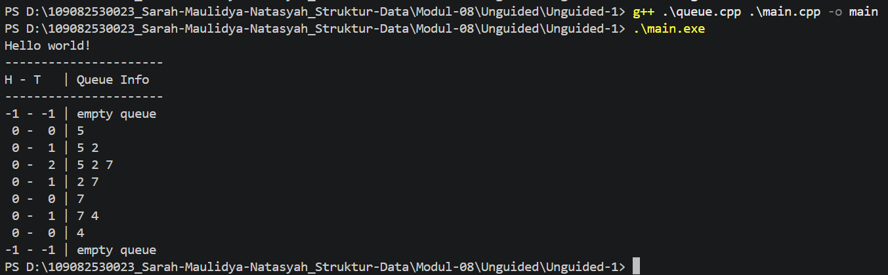
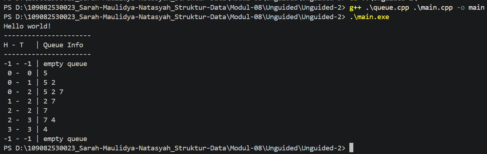
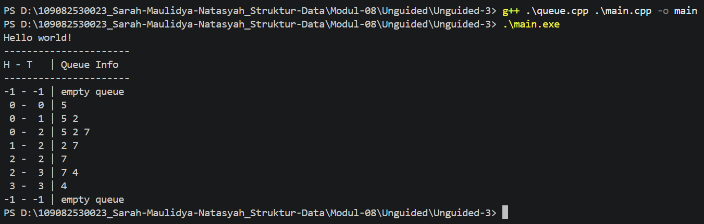

# <h1 align="center">Laporan Praktikum Modul 8 - Queue </h1>
<p align="center">Sarah Maulidya Natasyah - 109082530023</p>

## Dasar Teori
### A. Pengertian Queue<br/>
Queue atau antrean adalah struktur data linear yang menggunakan prinsip FIFO (First In First Out), yaitu elemen yang pertama masuk menjadi elemen yang pertama keluar [1]. Prinsip ini kebalikan dari stack yang memakai LIFO [2][3]. Queue bisa dibuat dengan array (representasi tabel) atau linked list (representasi pointer) [1].

Pada queue, penghapusan elemen dilakukan di bagian depan `Head` dan penambahan elemen dilakukan di bagian belakang `Tail` [1] [4]. Karena itu queue punya dua penunjuk, yaitu `Head` dan `Tail`, sedangkan stack hanya punya satu yaitu `Top`. Pada representasi pointer, setiap elemen mempunyai `info` untuk menyimpan data dan `next` untuk menunjuk elemen berikutnya. Queue kosong ditandai dengan `Head = Nil` [1].<br> 
Contoh kode:
```C++
typedef int infotype;
typedef struct elmQueue *address;
struct elmQueue {
    infotype info;
    address next;
};
struct queue {
    address head, tail;
};
```

### B. Operasi dalam Queue <br/>
#### 1. Enqueue (Insert)
Enqueue adalah operasi menambah elemen baru di belakang queue (`Tail`). Elemen baru dibuat dahulu, lalu `next` dari `Tail` lama diarahkan ke elemen baru, dan `Tail` dipindah ke elemen tersebut [1] [4].<br> 
Contoh kode:
```C++
void queue(address P){
    (Q.tail)->next = P;
    Q.tail = P;
}
```
#### 2. Dequeue (Delete) <br/>
Dequeue adalah operasi mengambil elemen di depan queue `Head`. Elemen `Head` disimpan di pointer `P`, lalu `Head` dipindah ke elemen berikutnya, dan `next` dari `P` diputus [1] [4].<br> 
Contoh kode:
```C++
address dequeue(address P) {
    P = Q.head;
    Q.head = P->next;
    P->next = Nil;
    return P;
}
```

### C. Primitif-Primitif dalam Queue<br/>
Primitif queue ditulis dalam ADT, dengan deklarasi di file `.h` dan implementasi di file `.c` atau `.cpp` [1]. Primitif yang biasanya dipakai yaitu:
#### 1. `isEmpty()`
#### 2. `CreateQueue()`
#### 3. `alokasi()` dan `dealokasi()`
#### 4. `findElm()` dan `fFindElm()`
#### 5. `insert()`
#### 6. `delete()`
#### 7. `printInfo()`, `nbList()`, dan `delAll()`

### D. Queue Representasi Tabel<br/>
Prinsip kerja queue tabel sama dengan queue pointer. Bedanya, jumlah antrean pada tabel terbatas dan tidak perlu manajemen memori [1]. Ada tiga alternatif cara membuatnya [1].
#### 1. Alternatif 1 (Head diam, Tail bergerak)
`Head` selalu di indeks awal selama queue tidak kosong, dan `Tail` menunjuk elemen terakhir. Saat queue kosong, `Head` dan `Tail` bernilai -1 pada kode C++ ini [1].
- Enqueue: `Tail` dimajukan. Jika queue kosong, `Head` diatur ke indeks awal.
- Dequeue: elemen di `Head` diambil, lalu semua elemen sesudahnya digeser maju satu posisi dan `Tail` mundur.
#### 2. Alternatif 2 (Head bergerak, Tail bergerak)
`Head` dan `Tail` sama-sama bergerak. `Head` maju ketika elemen dihapus [1].
- Enqueue: `Tail` dimajukan seperti alternatif 1.
- Dequeue: elemen di `Head` diambil lalu `Head` maju. 
#### 3. Alternatif 3 (Head dan Tail berputar)
`Head` dan `Tail` berputar dari indeks awal sampai akhir lalu kembali ke awal, sehingga tidak perlu menggeser elemen [1]. Ini disebut circular buffer [1][3].
- Enqueue: `Tail` dimajukan. Jika sudah di indeks maksimum, `Tail` pindah ke indeks awal.
- Dequeue: elemen di `Head` diambil, lalu `Head` maju dengan aturan perputaran yang sama.

## Guided
### 1. Program Queue Pointer
#### a. File queue.h 
```C++
#ifndef QUEUE_H_INCLUDE
#define QUEUE_H_INCLUDE

#include <iostream>
using namespace std;

#define Nil NULL

typedef bool boolean;
typedef int infotype;
typedef struct elmQ *address;

struct elmQ{
   infotype info;
   address next;
};

struct queue {
   address head, tail;
};

boolean isEmpty(queue Q);
void CreateQueue(queue &Q);
address alokasi(infotype X);
void dealokasi(address P);
address findElm(queue Q, infotype X);
boolean fFindElm(queue Q, address P);
void insert(queue &Q, address P);
void deleteQueue(queue &Q, address &P);
void printInfo(queue Q);
int nbList(queue Q);
void delAll(queue &Q);

#endif   
```
#### b. File queue.cpp
```C++
#include "queue.h"

boolean isEmpty(queue Q) {
    return (Q.head == Nil);
}

void CreateQueue(queue &Q) {
    Q.head = Nil;
    Q.tail = Nil;
}

address alokasi(infotype X) {
    address P = new (nothrow) elmQ;
    if (P != Nil) {
        P->info = X;
        P->next = Nil;
    }
    return P;
}

void dealokasi(address P) {
    delete P;
}

address findElm(queue Q, infotype X) {
    address P = Q.head;
    while (P != Nil) {
        if (P->info == X) {
            return P;
        }
        P = P->next;
    }
    return Nil;
}

boolean fFindElm(queue Q, address P) {
    address R = Q.head;
    while (R != Nil) {
        if (R == P) {
            return true;
        }
        R = R->next;
    }
    return false;
}

void insert(queue &Q, address P) { //enqueue
    if (isEmpty(Q)) {
        Q.head = P;
        Q.tail = P;
    } else {
        (Q.tail)->next = P;
        Q.tail = P;
    }
}

void deleteQueue(queue &Q, address &P) { //dequeue
    P = Q.head;
    if (Q.head == Q.tail) {
        Q.head = Nil;
        Q.tail = Nil;
    } else {
        Q.head = P->next;
    }
    P->next = Nil;
}

void printInfo(queue Q) {
    if (isEmpty(Q)) {
        cout << "Queue kosong" << endl;
    } else {
        address P = Q.head;
        while (P != Nil) {
            cout << P->info << " ";
            P = P->next;
        }
        cout << endl;
    }
}

int nbList(queue Q) {
    int jumlah = 0;
    address P = Q.head;
    while (P != Nil) {
        jumlah++;
        P = P->next;
    }
    return jumlah;
}

void delAll(queue &Q) {
    address P;
    while (!isEmpty(Q)) {
        deleteQueue(Q, P);
        dealokasi(P);
    }
}
```
#### c. File main.cpp
```C++
#include <iostream>
#include "queue.h"
using namespace std;

int main() {
    queue Q;
    address P; 

    CreateQueue(Q);
    cout << "isEmpty : " << isEmpty(Q) << endl;
    printInfo(Q);

    insert(Q, alokasi(5));
    insert(Q, alokasi(2));
    insert(Q, alokasi(7));
    cout << "Setelah insert 5, 2, 7" << endl;
    printInfo(Q);
    cout << "nbList  : " << nbList(Q) << endl;

    P = findElm(Q, 2);
    if (P != Nil) {
        cout << "findElm(2) ketemu, info = " << P->info << endl;
        cout << "fFindElm : " << fFindElm(Q, P) << endl;
    }
    if (findElm(Q, 9) == Nil) {
        cout << "findElm(9) tidak ketemu" << endl;
    }

    deleteQueue(Q, P);
    cout << "Setelah delete, elemen yang keluar = " << P->info << endl;
    dealokasi(P);
    printInfo(Q);

    delAll(Q);
    cout << "Setelah delAll" << endl;
    printInfo(Q);
    cout << "isEmpty : " << isEmpty(Q) << endl;

    return 0;
}
```
Program ini menggunakan ADT Queue berbasis pointer dengan struktur linked list yang memiliki penunjuk `head` dan `tail`. Program menyediakan fungsi untuk menambahkan, menghapus, mencari, dan menghitung elemen queue. Pada pengujian, data 5, 2, dan 7 dimasukkan sehingga jumlah elemen menjadi 3. Fungsi `findElm` berhasil menemukan data 2, sedangkan data 9 tidak ditemukan. Selanjutnya, `deleteQueue` mengeluarkan data 5 sesuai prinsip FIFO sehingga queue tersisa 2 dan 7. Terakhir, fungsi `delAll` menghapus seluruh elemen sehingga queue kembali kosong.

### 2. Program Queue Array
#### a. File queue-array.h 
```C++
#ifndef QUEUE_H
#define QUEUE_H

#include <iostream>
using namespace std;

const int MAKSIMAL = 5;

struct queue {
    string nama[MAKSIMAL];
    int head;
    int tail;
};

bool isFull(queue Q);
bool isEmpty(queue Q);
void CreateQueue(queue &Q);
void enQueue(queue &Q, string nama);
void deQueue(queue &Q);
void viewQueue(queue Q);

#endif
```
#### b. File queue-array.cpp
```C++
#include "queue-array.h"
#include <iostream>

using namespace std;

// NOTE : 
// Implementasi 1 = head diam, tail bergerak (Queue Linear Statis, kerana head nya tetap diam)
// Implementasi 2 = head bergerak, tail bergerak (Queue Linear Dinamis, karena head & tail nya sama-sama bergerak)
// Implementasi 3 = head dan tail berputar (Queue Circular, karena jika udh mentok tapi masih ada space, diputar sehingga tail bisa ada didepan head)

bool isEmpty(queue Q){
    if(Q.head == -1 && Q.tail == -1){
        return true;
    } else {
        return false;
    }
}

//isFull implmenetasi 1
bool isFull(queue Q){
    if(Q.tail == MAKSIMAL - 1){
        return true;
    } else {
        return false;
    }
}

// //isFull implementasi 2
// bool isFull(queue Q){
//     if(Q.head == 0 && Q.tail == MAKSIMAL - 1){
//         return true;
//     } else {
//         return false;
//     }
// }

// //isFull implementasi 3
// bool isFull(queue Q){
//     if((Q.tail + 1) % MAKSIMAL == Q.head){
//         return true;
//     } else {
//         return false;
//     }
// }

void CreateQueue(queue &Q){ //terbentuk queue dengan head = -1 dan tail = -1 
    Q.head = -1;
    Q.tail = -1;
}
 

//enqueue implementasi 1
void enQueue(queue &Q, string nama){
    if(isFull(Q) == true){
        cout << "Queue sudah penuh!" << endl;
    } else {
        if(isEmpty(Q) == true){
            Q.head = Q.tail = 0;
        } else {
            Q.tail++;
        }
        Q.nama[Q.tail] = nama;
        cout << "nama " << nama << " berhasil ditambahkan kedalam queue!" << endl;
    }
}

// //enQueue implementasi 2
// void enQueue(queue &Q, string nama){
//     if(isFull(Q) == true){
//         cout << "Queue sudah penuh!" << endl;
//     } else {
//         if(isEmpty(Q) == true){
//             Q.head = Q.tail = 0;
//         } else {
//             if(Q.tail == MAKSIMAL - 1){ // penuh semu, geser elemen ke kiri
//                 int selisih = Q.head;
//                 for(int i = Q.head; i <= Q.tail; i++){
//                     Q.nama[i - selisih] = Q.nama[i];
//                 }
//                 Q.tail = Q.tail - selisih;
//                 Q.head = 0;
//             }
//             Q.tail++;
//         }
//         Q.nama[Q.tail] = nama;
//         cout << "nama " << nama << " berhasil ditambahkan kedalam queue!" << endl;
//     }
// }

// //enQueue implementasi 3
// void enQueue(queue &Q, string nama){
//     if(isFull(Q) == true){
//         cout << "Queue sudah penuh!" << endl;
//     } else {
//         if(isEmpty(Q) == true){
//             Q.head = Q.tail = 0;
//         } else {
//             Q.tail = (Q.tail + 1) % MAKSIMAL; // bergerak melingkar
//         }
//         Q.nama[Q.tail] = nama;
//         cout << "nama " << nama << " berhasil ditambahkan kedalam queue!" << endl;
//     }
// }

//dequeue implementasi 1
void deQueue(queue &Q){
    if(isEmpty(Q) == true){
        cout << "Queue kosong!" << endl;
    } else {
        cout << "Menghapus data " << Q.nama[Q.head] << "..." << endl;
        for(int i = 0; i < Q.tail; i++){
            Q.nama[i] =  Q.nama[i+1];
        }
        Q.tail--;
        if(Q.tail < 0){ //kalo semua isi queue nya udh dikeluarin, set head & tail ke -1
            Q.head = -1;
            Q.tail = -1;
        }
    }
}

// //dequeue implementasi 2
// void deQueue(queue &Q){
//     if(isEmpty(Q) == true){
//         cout << "Queue kosong!" << endl;
//     } else {
//         cout << "Menghapus data " << Q.nama[Q.head] << "..." << endl;
//         Q.head++;
//         if(Q.head > Q.tail){ //kalo elemennya udh abis (head akan lebih 1 dari tail), maka reset ulang head & tail ke -1
//             Q.head = -1;
//             Q.tail = -1;
//         }
//     }
// }

// //deQueue implementasi 3
// void deQueue(queue &Q){
//     if(isEmpty(Q) == true){
//         cout << "Queue kosong!" << endl;
//     } else {
//         cout << "Menghapus data " << Q.nama[Q.head] << "..." << endl;
//         if(Q.head == Q.tail){ //kalo elemennya tinggal 1, langsungkan saja head & tail nya reset ke -1
//             Q.head = -1;
//             Q.tail = -1;
//         } else {
//             Q.head = (Q.head + 1) % MAKSIMAL; // bergerak melingkar
//         }
//     }
// }

//viewQueue implementasi 1 & 2
void viewQueue(queue Q){
    if(isEmpty(Q) == true){
        cout << "Queue kosong!" << endl;
    } else {
        for(int i = Q.head; i <= Q.tail; i++){
            cout << i -  Q.head + 1 << ". " << Q.nama[i] << endl;
        }
    }
    cout << endl;
}

// //viewQueue implementasi 3
// void viewQueue(queue Q){
//     if(isEmpty(Q) == true){
//         cout << "Queue kosong!" << endl;
//     } else {
//         int i = Q.head;
//         int count = 1;
//         while(true){
//             cout << count << ". " << Q.nama[i] << endl;
//             if(i == Q.tail){
//                 break;
//             }
//             i = (i + 1) % MAKSIMAL;
//             count++;
//         }   
//     }
// }
```
#### c. File main.cpp
```C++
#include "queue-array.h"
#include <iostream>

using namespace std;

int main(){
    queue Q;

    CreateQueue(Q);
    enQueue(Q, "Dimas");
    enQueue(Q, "Arvin");
    enQueue(Q, "Rizal");
    enQueue(Q, "Hafizh");
    enQueue(Q, "Fathur");
    enQueue(Q, "Daffa");
    cout << endl;

    cout << "--- Isi Queue Setelah enQueue ---" << endl;
    viewQueue(Q);
    cout << endl;

    deQueue(Q);
    deQueue(Q);
    deQueue(Q);
    deQueue(Q);
    // deQueue(Q);
    // deQueue(Q);
    cout << endl;

    cout << "--- Isi Queue Setelah deQueue ---" << endl;
    viewQueue(Q);

    return 0;
}
```
Program ini menggunakan ADT Queue berbasis `array` dengan tipe data `string` untuk menyimpan nama. Queue memiliki kapasitas maksimal 5 elemen dan menerapkan Alternatif 1. Pada pengujian, lima nama berhasil dimasukkan, sedangkan nama Daffa ditolak karena queue sudah penuh. Selanjutnya, dilakukan empat kali `deQueue` yang mengeluarkan Dimas, Arvin, Rizal, dan Hafizh sesuai prinsip FIFO, sehingga tersisa nama Fathur di dalam queue.

## Unguided 
### 1. Buatlah ADT Queue menggunakan ARRAY sebagai berikut di dalam file “queue.h”:
```C++
Type infotype: integer
Type Queue: <
    info : array [5] of infotype {index array dalam C++ dimulai dari 0}
    head, tail : integer
>
procedure CreateQueue (input/output Q: Queue)
function isEmptyQueue (Q: Queue) → boolean
function isFullQueue (Q: Queue) → boolean
procedure enqueue (input/output Q: Queue, input x: infotype)
function dequeue (input/output Q: Queue) → infotype
procedure printInfo (input Q: Queue)
```
Buatlah implementasi ADT Queue pada file “queue.cpp” dengan menerapkan mekanisme queue Alternatif 1 (head diam, tail bergerak).
```C++
int main() {
    cout << "Hello World" << endl;
    Queue Q;
    createQueue(Q);

    cout<<"----------------------"<<endl;
    cout<<" H - T \t | Queue info"<<endl;
    cout<<"----------------------"<<endl;
    printInfo(Q);
    enqueue(Q,5); printInfo(Q);
    enqueue(Q,2); printInfo(Q);
    enqueue(Q,7); printInfo(Q);
    dequeue(Q); printInfo(Q);
    enqueue(Q,4); printInfo(Q);
    dequeue(Q); printInfo(Q);
    dequeue(Q); printInfo(Q);
    
    return 0;
}
```
Contoh Output<br\>
```
Hello world!
---------------------
 H - T  : Queue Info
---------------------
-1 - -1 : empty queue
0 - 0   : 5
0 - 1   : 5 2
0 - 2   : 5 2 7
0 - 1   : 2 7
0 - 0   : 7
0 - 1   : 7 4
0 - 0   : 4
-1 - -1 : empty queue
----------------------
```
#### a. File queue.h
```C++
#ifndef QUEUE_H_INCLUDED
#define QUEUE_H_INCLUDED

#include <iostream>
using namespace std;

typedef int infotype;

struct Queue {
    infotype info[5];
    int head, tail;
};

void createQueue(Queue &Q);
bool isEmptyQueue(Queue Q);
bool isFullQueue(Queue Q);
void enqueue(Queue &Q, infotype x);
infotype dequeue(Queue &Q);
void printInfo(Queue Q);

#endif
```
#### b. File queue.cpp
```C++
#include "queue.h"

// Alternatif 1
void createQueue(Queue &Q) {
    Q.head = -1;
    Q.tail = -1;
}

bool isEmptyQueue(Queue Q) {
    return Q.head == -1 && Q.tail == -1;
}

bool isFullQueue(Queue Q) {
    return Q.tail == 4;
}

void enqueue(Queue &Q, infotype x) {
    if (isFullQueue(Q)) {
        cout << "Queue penuh!" << endl;
        return;
    }
    if (isEmptyQueue(Q)) {
        Q.head = 0;
        Q.tail = 0;
    } else {
        Q.tail++;
    }
    Q.info[Q.tail] = x;
}

infotype dequeue(Queue &Q) {
    if (isEmptyQueue(Q)) {
        cout << "Queue kosong!" << endl;
        return -1;
    }
    infotype x = Q.info[Q.head];
    if (Q.tail == 0) {
        Q.head = -1;
        Q.tail = -1;
    } else {
        for (int i = 0; i < Q.tail; i++) {
            Q.info[i] = Q.info[i + 1];
        }
        Q.tail--;
    }
    return x;
}

void printInfo(Queue Q) {
    if (Q.head == -1) {
        cout << "-1 - -1 | ";
    } else {
        cout << " " << Q.head << " -  " << Q.tail << " | ";
    }

    if (isEmptyQueue(Q)) {
        cout << "empty queue";
    } else {
        for (int i = Q.head; i <= Q.tail; i++) {
            cout << Q.info[i] << " ";
        }
    }
    cout << endl;
}
```
#### c. File main.cpp
```C++
#include "queue.h"

int main() {
    cout << "Hello world!" << endl;
    Queue Q;
    createQueue(Q);

    cout << "----------------------" << endl;
    cout << "H - T \t| Queue Info" << endl;
    cout << "----------------------" << endl;

    printInfo(Q);
    enqueue(Q, 5); printInfo(Q);
    enqueue(Q, 2); printInfo(Q);
    enqueue(Q, 7); printInfo(Q);
    dequeue(Q);    printInfo(Q);
    dequeue(Q);    printInfo(Q);
    enqueue(Q, 4); printInfo(Q);
    dequeue(Q);    printInfo(Q);
    dequeue(Q);    printInfo(Q);

    return 0;
}
```
### Output Unguided 1 :

##### Output 1

Program ini menggunakan ADT Queue dengan `array` berukuran 5 dan menerapkan Alternatif 1. Pada Alternatif 1, `head` selalu di indeks 0 dan hanya `tail` yang bergerak saat `enqueue`. Saat `dequeue`, elemen paling depan diambil lalu elemen sisanya digeser maju satu posisi, sehingga `tail` berkurang satu. Setelah `dequeue` pertama, isi queue berubah dari 5 2 7 menjadi 2 7 dengan `head` tetap 0 dan tail turun dari 2 menjadi 1. Queue kosong ditandai `head` dan `tail` bernilai -1, dan queue dianggap penuh jika `tail` berada di indeks 4. `dequeue` terakhir mengeluarkan elemen 4 sehingga queue kembali kosong.

### 2. Buatlah implementasi ADT Queue pada file “queue.cpp” dengan menerapkan mekanisme queue Alternatif 2 (head bergerak, tail bergerak).
#### a. File queue.h
```C++
#ifndef QUEUE_H_INCLUDED
#define QUEUE_H_INCLUDED

#include <iostream>
using namespace std;

typedef int infotype;

struct Queue {
    infotype info[5];
    int head;
    int tail;
};

void createQueue(Queue &Q);
bool isEmptyQueue(Queue Q);
bool isFullQueue(Queue Q);
void enqueue(Queue &Q, infotype x);
infotype dequeue(Queue &Q);
void printInfo(Queue Q);

#endif
```
#### b. File queue.cpp
```C++
#include "queue.h"

// Alternatif 2
void createQueue(Queue &Q) {
    Q.head = -1;
    Q.tail = -1;
}

bool isEmptyQueue(Queue Q) {
    return Q.head == -1 && Q.tail == -1;
}

bool isFullQueue(Queue Q) {
    return Q.head == 0 && Q.tail == 4;
}

void enqueue(Queue &Q, infotype x) {
    if (isFullQueue(Q)) {
        cout << "Queue penuh!" << endl;
        return;
    }
    if (isEmptyQueue(Q)) {
        Q.head = 0;
        Q.tail = 0;
    } else {
        if (Q.tail == 4) {
            int n = Q.tail - Q.head + 1;
            for (int i = 0; i < n; i++) {
                Q.info[i] = Q.info[Q.head + i];
            }
            Q.head = 0;
            Q.tail = n - 1;
        }
        Q.tail++;
    }
    Q.info[Q.tail] = x;
}

infotype dequeue(Queue &Q) {
    if (isEmptyQueue(Q)) {
        cout << "Queue kosong!" << endl;
        return -1;
    }
    infotype x = Q.info[Q.head];
    if (Q.head == Q.tail) {
        Q.head = -1;
        Q.tail = -1;
    } else {
        Q.head++;
    }
    return x;
}

void printInfo(Queue Q) {
    if (Q.head == -1) {
        cout << "-1 - -1 | ";
    } else {
        cout << " " << Q.head << " -  " << Q.tail << " | ";
    }

    if (isEmptyQueue(Q)) {
        cout << "empty queue";
    } else {
        for (int i = Q.head; i <= Q.tail; i++) {
            cout << Q.info[i] << " ";
        }
    }
    cout << endl;
}
```
#### c. File main.cpp
```C++
#include "queue.h"

int main() {
    cout << "Hello world!" << endl;
    Queue Q;
    createQueue(Q);

    cout << "----------------------" << endl;
    cout << "H - T \t| Queue Info" << endl;
    cout << "----------------------" << endl;

    printInfo(Q);
    enqueue(Q, 5); printInfo(Q);
    enqueue(Q, 2); printInfo(Q);
    enqueue(Q, 7); printInfo(Q);
    dequeue(Q);    printInfo(Q);
    dequeue(Q);    printInfo(Q);
    enqueue(Q, 4); printInfo(Q);
    dequeue(Q);    printInfo(Q);
    dequeue(Q);    printInfo(Q);

    return 0;
}
```

### Output Unguided 2 :
##### Output 1

Program ini menggunakan ADT Queue dengan mekanisme Alternatif 2. Pada Alternatif 2, `head` dan `tail` sama-sama bergerak. `dequeue` hanya memajukan `head` tanpa menggeser elemen, jadi lebih efisien. Di output terlihat `head` naik dari 0 menjadi 1 setelah `dequeue` pertama, sedangkan `tail` tetap 2 sehingga isi queue menjadi 2 7. Kelemahannya adalah penuh semu, yaitu `tail` sudah di indeks 4 padahal masih ada ruang kosong di depan `head`. Karena itu `enqueue` menggeser elemen ke awal `array` jika `tail` sudah di indeks 4 dan `head` belum 0. Pada pengujian ini `tail` tidak sampai indeks 4, jadi pergeseran belum terjadi. Queue dinyatakan penuh jika head di indeks 0 dan `tail` di indeks 4.

### 3. Buatlah implementasi ADT Queue pada file “queue.cpp” dengan menerapkan mekanisme queue Alternatif 3 (head dan tail berputar).
#### a. File queue.h
```C++
#ifndef QUEUE_H_INCLUDED
#define QUEUE_H_INCLUDED

#include <iostream>
using namespace std;

typedef int infotype;

struct Queue {
    infotype info[5];
    int head;
    int tail;
};

void createQueue(Queue &Q);
bool isEmptyQueue(Queue Q);
bool isFullQueue(Queue Q);
void enqueue(Queue &Q, infotype x);
infotype dequeue(Queue &Q);
void printInfo(Queue Q);

#endif
```
#### b. File queue.cpp
```C++
#include "queue.h"

// Alternatif 3
void createQueue(Queue &Q) {
    Q.head = -1;
    Q.tail = -1;
}

bool isEmptyQueue(Queue Q) {
    return Q.head == -1 && Q.tail == -1;
}

bool isFullQueue(Queue Q) {
    return !isEmptyQueue(Q) && (Q.tail + 1) % 5 == Q.head;
}

void enqueue(Queue &Q, infotype x) {
    if (isFullQueue(Q)) {
        cout << "Queue penuh!" << endl;
        return;
    }
    if (isEmptyQueue(Q)) {
        Q.head = 0;
        Q.tail = 0;
    } else {
        Q.tail = (Q.tail + 1) % 5;
    }
    Q.info[Q.tail] = x;
}

infotype dequeue(Queue &Q) {
    if (isEmptyQueue(Q)) {
        cout << "Queue kosong!" << endl;
        return -1;
    }
    infotype x = Q.info[Q.head];
    if (Q.head == Q.tail) {
        Q.head = -1;
        Q.tail = -1;
    } else {
        Q.head = (Q.head + 1) % 5;
    }
    return x;
}

void printInfo(Queue Q) {
    if (Q.head == -1) {
        cout << "-1 - -1 | ";
    } else {
        cout << " " << Q.head << " -  " << Q.tail << " | ";
    }

    if (isEmptyQueue(Q)) {
        cout << "empty queue";
    } else {
        for (int i = Q.head; i <= Q.tail; i++) {
            cout << Q.info[i] << " ";
        }
    }
    cout << endl;
}
```
#### c. File main.cpp
```C++
#include "queue.h"

int main() {
    cout << "Hello world!" << endl;
    Queue Q;
    createQueue(Q);

    cout << "----------------------" << endl;
    cout << "H - T \t| Queue Info" << endl;
    cout << "----------------------" << endl;

    printInfo(Q);
    enqueue(Q, 5); printInfo(Q);
    enqueue(Q, 2); printInfo(Q);
    enqueue(Q, 7); printInfo(Q);
    dequeue(Q);    printInfo(Q);
    dequeue(Q);    printInfo(Q);
    enqueue(Q, 4); printInfo(Q);
    dequeue(Q);    printInfo(Q);
    dequeue(Q);    printInfo(Q);

    return 0;
}
```
### Output Unguided 3 :

##### Output 1

Program ini menggunakan ADT Queue dengan mekanisme Alternatif 3. Pada Alternatif 3, `head` dan `tail` bergerak melingkar memakai operasi modulo, jadi setelah indeks 4 posisi berikutnya kembali ke indeks 0 dan tidak perlu ada pergeseran elemen. Queue dinyatakan penuh jika posisi setelah `tail` sama dengan `head`. Pada pengujian ini `tail` tidak sampai indeks 4, sehingga hasilnya sama dengan Alternatif 2. Perbedaannya baru terlihat kalau `tail` melewati indeks 4, yaitu saat `tail` pindah ke indeks 0 sementara `head` masih di depan.

## Kesimpulan
Berdasarkan praktikum yang telah dilakukan, dapat disimpulkan bahwa queue menggunakan prinsip FIFO (First In First Out), yaitu data yang pertama masuk menjadi data yang pertama keluar. Operasi utamanya adalah `enqueue` untuk menambah data dan `dequeue` untuk mengambil data. Tiga alternatif implementasi dengan `array` punya kelebihan dan kekurangan masing-masing. Alternatif 1 sederhana, tetapi setiap `dequeue` menggeser elemen. Alternatif 2 lebih efisien karena hanya memajukan `head`, tetapi bisa mengalami penuh semu. Alternatif 3 memakai sistem melingkar sehingga tidak perlu pergeseran dan seluruh ruang `array` bisa dipakai.

## Referensi
[1] Informatics Lab, "Modul 8: Queue," in Modul Praktikum Struktur Data. Bandung, Indonesia: Fakultas Informatika, Telkom University, n.d., pp. 66-75. <br>
[2] G. A. V. Pai, A Textbook of Data Structures and Algorithms 1: Mastering Linear Data Structures. Hoboken, NJ, USA: Wiley-ISTE, 2023, doi: 10.1002/9781394192076. <br>
[3] M. T. Goodrich, R. Tamassia, and D. M. Mount, Data Structures and Algorithms in C++, 2nd ed. Hoboken, NJ, USA: Wiley, 2011. <br>
[4] T. H. Cormen, C. E. Leiserson, R. L. Rivest, and C. Stein, Introduction to Algorithms, 4th ed. Cambridge, MA, USA: MIT Press, 2022.